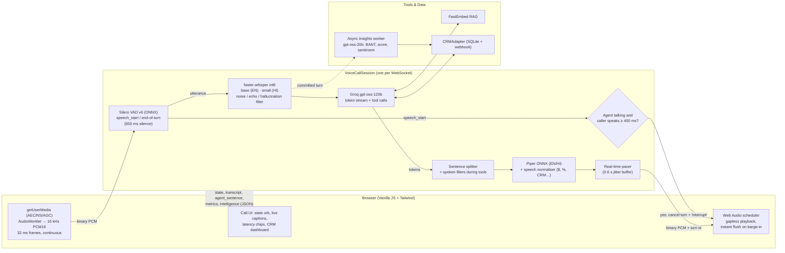
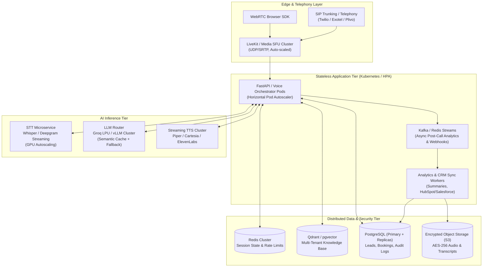

# System Architecture — Autonomous AI Sales Voice Agent

## 1. MVP Real-Time Voice Call Architecture (Local + Groq)

### Turn-taking rules
| Situation | Behaviour |
|---|---|
| Caller stops talking for 650 ms | End of turn → STT → answer (`VAD_END_OF_TURN_MS`) |
| Caller pauses, then continues before Aria speaks | Half-built answer is cancelled; both audio segments are transcribed together as one turn |
| Caller talks over Aria for ≥ 400 ms | **Barge-in**: server cancels LLM/TTS, client flushes queued audio within one frame; history stores only what was actually heard + `[interrupted by caller]` (`VAD_BARGE_IN_MS`) |
| Barge-in disabled (laptop speakers) | Speech during Aria's turn is ignored (half-duplex) |
| Noise, hum, cough, Whisper "Thank you." hallucination, Aria's own voice leaking back | Rejected (VAD, Whisper no-speech prob, hallucination list, echo-overlap check) |
| Tool call (RAG / calendar) | Aria says a short filler ("Let me check that for you") so the line is never silent |

---

## 2. Production Scalability Architecture (100,000+ Users)

---

## 3. Voice-to-Voice Latency (measured on the MVP)

Measured by `tests/test_voice_call_e2e.py::test_live_groq_call` and the browser test (12-core laptop CPU, Groq cloud).
"Voice-to-voice" = moment the caller stops speaking (end-of-turn fired) → first agent audio leaves the server.
The 650 ms end-of-turn silence comes on top of it.

| Stage | English | Hindi | Production target (GPU / streaming) |
|---|---|---|---|
| End-of-turn detection (silence) | 650 ms | 650 ms | 300–500 ms + semantic end-of-turn model |
| STT | ~380–430 ms (Whisper base) | ~1.0–1.4 s (Whisper small, beam 5) | ~100–150 ms streaming GPU STT |
| LLM first token (Groq, reasoning_effort=low) | ~200–600 ms (1.1 s with a tool call) | ~1.2 s | ~150–250 ms |
| TTS first sentence (Piper) | ~45–80 ms | ~55 ms | ~50–80 ms |
| **Voice-to-voice** | **~0.83–0.85 s** | **~1.8 s** | **~0.5 s** |

With a tool call the filler sentence ("Let me check that for you") is spoken immediately, which keeps perceived latency at ~0.85 s even though the RAG + second LLM step takes ~1.1 s.
