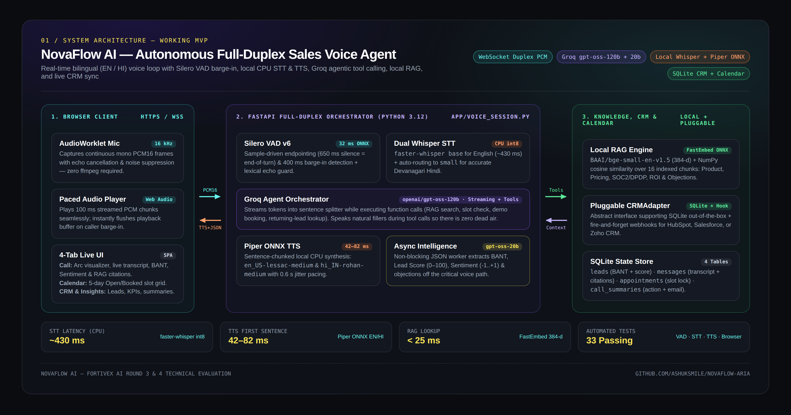
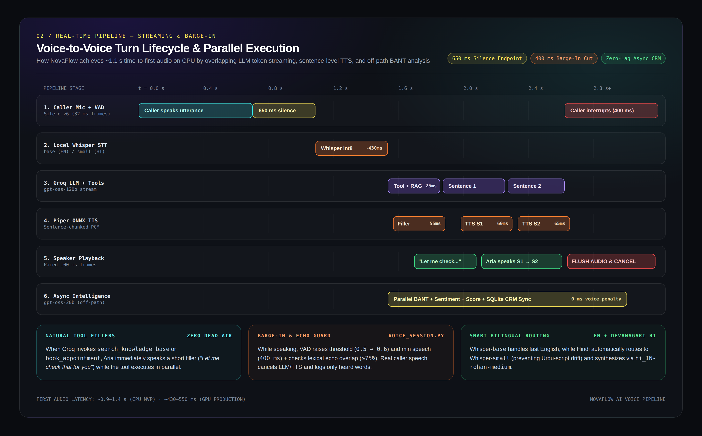
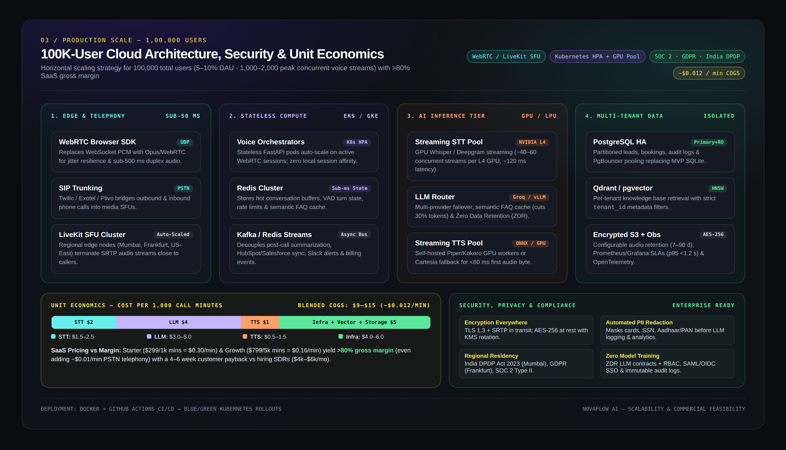

# Fortivex AI — Round 3 & Round 4 Interview & Demo Guide

> **Project:** NovaFlow AI — Autonomous Full-Duplex Sales Voice Agent  
> **Repository:** https://github.com/ashuksmile/novaflow-aria

---

## 1. Your 90-Second Opening Pitch (What to Say First)

Start confident, structured, and business-first (Fortivex specifically evaluates **product & business understanding**, not just code):

> *"I built **NovaFlow AI**, a real-time, full-duplex, bilingual (**English + Hindi**) Autonomous AI Sales Voice Agent.
>
> **The business problem:** B2B sales teams lose 35–50% of inbound leads because average speed-to-lead is over 4 hours, SDRs cost $4,000–$6,000/month per rep, and CRM hygiene is manual and inconsistent.
>
> **What I engineered:** This is a true **full-duplex voice agent**, not a chat app with a TTS button. The browser streams continuous 16 kHz PCM audio over a WebSocket into a **Silero VAD v6** turn detector on the backend. When the prospect stops speaking (650 ms silence), local CPU **faster-whisper** transcribes it, **Groq (`openai/gpt-oss-120b`)** streams tokens with live tool calling — querying a local **FastEmbed RAG** knowledge base and our **Calendar/CRM** — while **Piper ONNX TTS** synthesizes and streams audio sentence-by-sentence back in ~1 second.
>
> **Two details I'm proud of:** First, **full-duplex barge-in with echo guard** — if the caller interrupts Aria mid-sentence, she stops immediately and only logs what the caller actually heard. Second, **non-blocking sales intelligence** — a parallel `gpt-oss-20b` worker extracts BANT, Lead Score, Sentiment, and syncs the CRM off the voice path with zero added latency. And everything is verified by **33 automated tests**, including real speech WER tests and a headless browser call."*

---

## 2. Architecture Visuals (Show These During Your Presentation)

### A. System Architecture (MVP)


### B. Full-Duplex Voice Turn Flow & Barge-In


### C. 100,000-User Scalability, Security & Unit Economics


---

## 3. Step-by-Step 3-Minute Live Demo Script

Run the server beforehand (HTTPS is required by browsers for microphone access over LAN; `localhost` also works):
```bash
.venv/bin/uvicorn app.main:app --host 0.0.0.0 --port 8443 --ssl-keyfile certs/dev-key.pem --ssl-certfile certs/dev-cert.pem --reload
```

| Step | What You Do / Say | What to Point Out to the Interviewer |
|---|---|---|
| **1. Start Call** | Click **Start call** (`Space`). Wait for Aria's voice greeting. | Point out the live audio-reactive arc visualizer and continuous mic level meter (no push-to-talk button). |
| **2. BANT + RAG (English)** | Say: *"Hi, I'm Rahul from Acme Tech, VP of Sales. We have 20 reps and want to know what your Growth plan costs."* | Point out: (a) **Filler phrase** (*"Let me check that for you"*) while `TOOL / search_knowledge_base` runs, (b) **RAG Sources** appearing on the right panel with cosine similarity scores, (c) **Lead Score, BANT, and Positive Sentiment** updating asynchronously. |
| **3. Barge-In Demo** | While Aria is answering, speak over her (use headphones or keep speakers low): *"Wait, hold on — does it integrate with Salesforce?"* | Show that Aria **cuts off immediately**, marks the previous message **"Interrupted by caller"**, and answers the new question. |
| **4. Multilingual Hindi** | Switch language to `Auto` or `Hindi` and say: *"क्या आपका डेटा भारत में स्टोर होता है? क्या यह SOC 2 compliant है?"* | Highlight automatic routing to Whisper-`small` (Devanagari Hindi), RAG retrieval of `security_and_compliance.md` (India DPDP Act 2023 + Mumbai residency), and native Hindi voice via Piper `hi_IN-rohan-medium`. |
| **5. Automated Booking** | Say: *"Sounds great. Book a demo for tomorrow at 11:30 AM IST. My email is rahul@acmetech.io."* | Show `TOOL / check_available_slots` → `TOOL / book_appointment` firing automatically and Lead Stage jumping to **Demo Booked (85/100)**. |
| **6. End Call & 4-Tab Tour** | Click **End call** (auto-generates summary), then click **Calendar**, **CRM**, and **Insights** in the top navbar. | Show the **Booked slot** highlighted in the 5-day Calendar grid, the scored lead in **CRM**, and the executive summary + ready-to-send follow-up email in **Insights**. |

> **Noisy Interview Room Backup:** If the room is loud or echoey, untick **Barge-in** (half-duplex mode) or use the bottom **Type /** bar — Aria still runs full RAG, tools, CRM sync, and **speaks her reply out loud**.

---

## 4. Tough Round 3 & Round 4 Interview Questions (With Crisp Answers)

### Q1: Why is this a "real voice agent" and not just a chatbot with TTS?
- **Answer:** A chatbot waits for a button press, sends a full audio file, waits for the full LLM response, and generates one giant MP3 (4–6 seconds of silence). Here:
  1. The browser streams continuous 16 kHz PCM frames via `AudioWorklet` (`Mic16k`).
  2. Server-side **Silero VAD v6** detects speech start/end deterministically on 32 ms audio frames.
  3. **Groq LLM tokens stream into a sentence splitter** -> `sentence_q` -> **Piper TTS synthesizes sentence 1 while sentence 2 is still being generated** -> paced 100 ms PCM frames play immediately.
  4. **Barge-in** cancels running LLM + TTS tasks mid-flight and flushes browser playback buffers.

### Q2: How did you prevent speaker echo from triggering false barge-ins?
- **Answer:** Three layers of defense (`app/voice_session.py`):
  1. Browser `getUserMedia` enables hardware AEC (`echoCancellation: true`, `noiseSuppression: true`, `autoGainControl: true`).
  2. While Aria is speaking, VAD dynamically raises its threshold (`0.5 → 0.6`) and required sustained speech (`160 ms → 400 ms`) so short coughs, "mm-hmm", or bleed don't interrupt her.
  3. After STT, `looks_like_echo()` checks word overlap against `last_agent_text` (≥75% overlap is rejected as speaker bleed).

### Q3: Why did you use TWO Whisper models (`base` + `small`)?
- **Answer:** Real empirical testing! When we tested real Hindi speech (FLEURS dataset in `tests/test_stt.py`), Whisper-`base` frequently transcribed Hindi into **Urdu/Arabic script**, which broke Piper's Devanagari Hindi phonemizer (`hi_IN-rohan-medium`). Routing English to `base` (~430 ms) and Hindi to `small` gives both low English latency and clean Devanagari Hindi accuracy.

### Q4: How do you prevent LLM hallucinations on pricing, security, or bookings?
- **Answer:**
  1. **Grounded RAG:** The system prompt mandates calling `search_knowledge_base` before answering product, pricing, security, or ROI questions, and the UI surfaces every retrieved chunk + cosine score for auditability.
  2. **Deterministic Tool Execution:** Aria never invents available slots or fake bookings — she must call `check_available_slots()` and `book_appointment()`, which enforces a SQLite double-booking lock.

### Q5: Why run BANT & Sentiment on a separate async model (`gpt-oss-20b`)?
- **Answer:** Voice latency is sacred. Asking the main conversational model to output giant JSON blobs breaks token-to-sentence streaming and adds 400–800 ms of delay. Spawning `_intelligence()` via `asyncio.create_task` on a faster model (`openai/gpt-oss-20b` JSON mode) keeps CRM/BANT/Sentiment real-time with **0 ms voice latency penalty**.

### Q6: How would you scale this to 100,000 users?
- **Answer:** Break down traffic math first (interviewers love back-of-the-envelope math):
  - **100,000 total users** × ~5–10% DAU = 5k–10k active users/day -> **~1,000–2,000 peak concurrent calls**.
  - **Transport:** Move from WebSocket PCM to **WebRTC / LiveKit SFUs** + SIP trunking (Twilio/Exotel) for UDP resilience and PSTN phone calls.
  - **Compute:** Stateless FastAPI orchestrator pods on **Kubernetes (HPA)**; move `session_histories` out of RAM into **Redis Cluster**.
  - **AI Inference:** Offload CPU Whisper/Piper to autoscaling **NVIDIA L4 GPU pools** (~40–60 concurrent streams per L4 -> ~30–40 GPUs at peak), plus semantic FAQ caching in Redis (~30% token reduction).
  - **Data & Async:** SQLite → **PostgreSQL HA (PgBouncer + read replicas)**; NumPy RAG → **Qdrant / pgvector** with strict `tenant_id` filtering; post-call summaries & CRM webhooks → **Kafka / Redis Streams**.

### Q7: Walk me through the unit economics and commercial feasibility.
- **Answer:** Per **1,000 call minutes** at scale:
  - Self-hosted GPU Whisper STT: **~$1.50–$2.50**
  - Groq LLM (`120B` chat + `20B` async intelligence): **~$3.00–$5.00**
  - Self-hosted Piper/GPU TTS: **~$0.50–$1.50**
  - Infra, Qdrant, Postgres, encrypted S3: **~$4.00–$6.00**
  - **Total COGS:** **~$9–$15 / 1,000 mins (~$0.012/min)** (+ ~$0.01/min if PSTN telephony is included).
  - **Revenue:** Starter ($299/1k mins = $0.30/min), Growth ($799/5k mins = $0.16/min) -> **>80% SaaS gross margin**, paying back customers in **4–6 weeks** vs a $4,000+/mo human SDR.

### Q8: How do you handle Data Security, PII, and Indian/Global Compliance?
- **Answer:**
  - **In transit:** TLS 1.3 + SRTP for WebRTC/SIP audio.
  - **At rest:** AES-256 encryption for PostgreSQL, vector store, and S3 recordings with configurable TTL (7/30/90 days or delete-on-transcribe).
  - **PII Redaction:** Regex/NER middleware scrubs Aadhaar, PAN, SSN, and credit card numbers before logging transcripts or sending analytics.
  - **Compliance & Residency:** Zero Data Retention (ZDR) LLM agreements (never trained on customer data), regional deployment for **India DPDP Act 2023 (Mumbai)**, **GDPR (Frankfurt)**, and **SOC 2 Type II** + SAML/OIDC SSO & audit logs.

### Q9: How did you test that the voice actually sounds intelligible and isn't broken noise?
- **Answer:** We built a **33-test automated suite** (`pytest`):
  - `tests/test_vad.py` — Unit tests Silero VAD end-of-turn and barge-in timing.
  - `tests/test_stt.py` — Runs real English (LibriSpeech) and Hindi (FLEURS) WAV fixtures and asserts low Word Error Rate (WER).
  - `tests/test_tts_quality.py` — Synthesizes Piper EN & HI speech, checks RMS/clipping/speech ratio, and **round-trips the audio back through Whisper** to prove intelligibility.
  - `tests/test_browser_call.py` — Launches headless Chromium with a fake mic device playing a real WAV question into our live UI, captures Aria's speaker output from Web Audio, and verifies WER ≤ 0.30.

---

## 5. Live Coding & Real-Time Modification Cheat Sheet

If the interviewer asks you to **modify the project live** during Round 3/4, jump straight to these exact files:

| Live Modification Request | Exact File to Edit | What to Change |
|---|---|---|
| **Add a new knowledge base topic** (e.g., refund policy or competitor battlecard) | `knowledge_base/*.md` | Drop a new `.md` file with `##` sections and restart — `app/rag.py` auto-chunks and embeds it on boot. |
| **Add a new agent tool** (e.g., `send_pricing_pdf` or `escalate_to_human`) | `app/agent.py` | 1) Add JSON schema to `TOOLS` list, 2) add `elif fn_name == "..."` handler in `_execute_tool()`, 3) optionally add a spoken filler in `FILLERS` in `app/voice_session.py`. |
| **Change agent persona / language / sales script** | `app/agent.py` | Edit `_build_system_prompt()` (and `GREETINGS` in `app/voice_session.py`). |
| **Tune end-of-turn speed or barge-in sensitivity** | `.env` or `app/config.py` | Adjust `VAD_END_OF_TURN_MS` (default `650`) and `VAD_BARGE_IN_MS` (default `400`). |
| **Change BANT scoring or add a custom CRM field** | `app/insights.py` + `app/database.py` | Add key to the JSON prompt in `analyze_turn()` and column/allowed field in `database.py`. |
| **Connect a real HubSpot / Slack / Zapier webhook** | `.env` (`CRM_WEBHOOK_URL`) | Set `CRM_WEBHOOK_URL=https://...` — `SQLiteCRMAdapter._emit_webhook()` in `app/crm.py` already fires `lead.updated` and `appointment.booked` events automatically. |
| **Add interactive cancel/manual booking to Calendar UI** | `app/main.py` + `frontend/index.html` | Add `POST /api/appointments` or `DELETE /api/appointments/{id}` in `main.py` calling `db.create_appointment` / SQL update, and wire a click handler on `.slot` in `loadCalendar()`. |

---

## 6. Morning Checklist (Before 8:30 AM)

- [ ] Laptop fully charged + charger + **headphones/earphones** (makes live barge-in demo 100% echo-free!).
- [ ] Verify `.env` has a valid `GROQ_API_KEY` and test 1 quick call before walking into room **32-313**.
- [ ] Keep **3 browser tabs / files ready**:
  1. Live app (`https://localhost:8443` or `http://localhost:8000`)
  2. GitHub repo (`https://github.com/ashuksmile/novaflow-aria`)
  3. The 3 diagram PNGs in `docs/diagrams/` (open in an image viewer for crisp full-screen presentation).
- [ ] Physical items from email: 2 copies of updated CV, 2 photographs, college ID, original + photocopy of govt ID & academic transcripts, formals.
